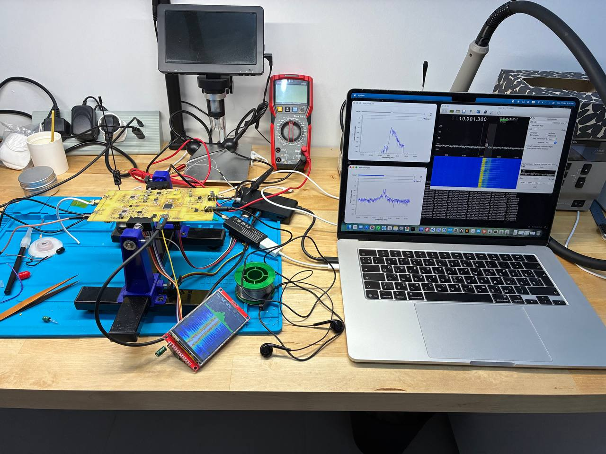
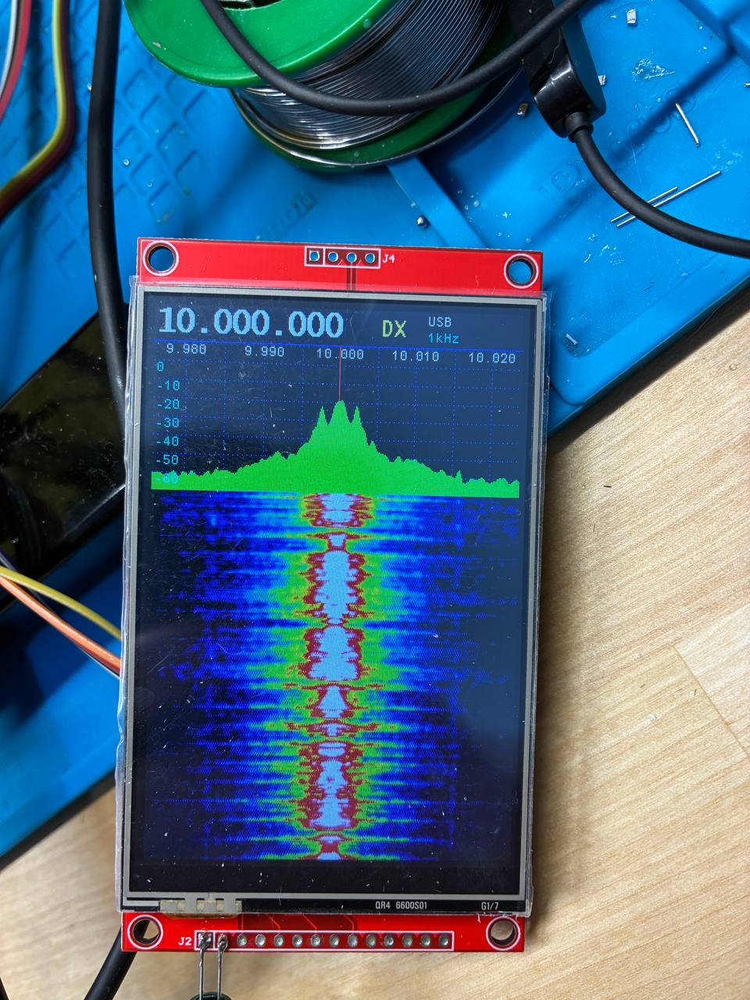
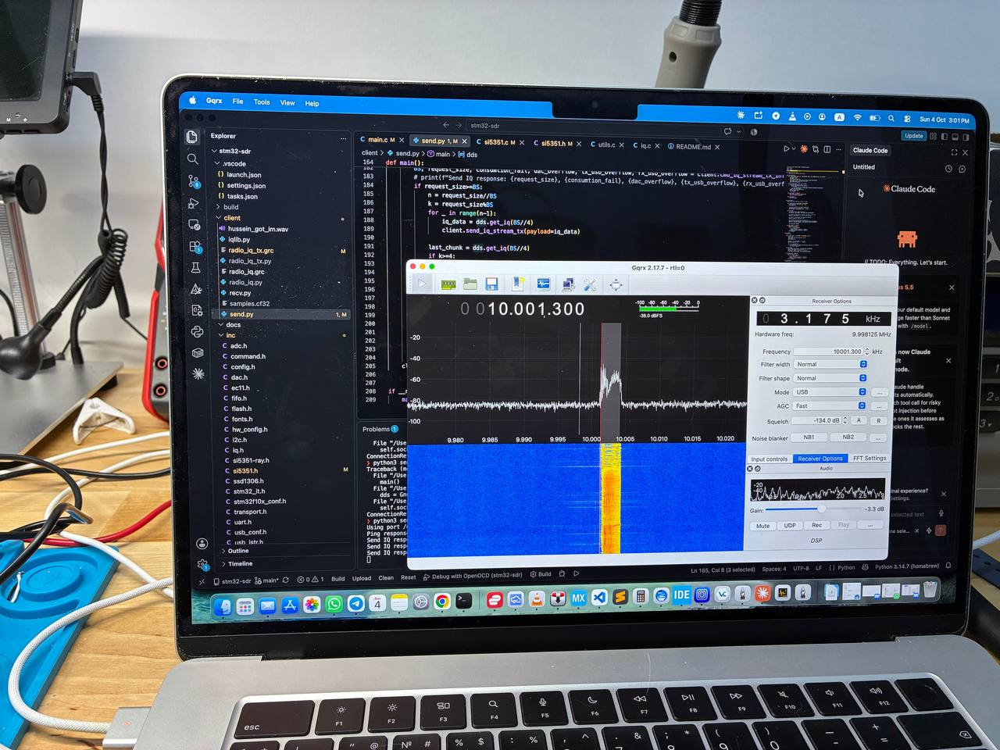
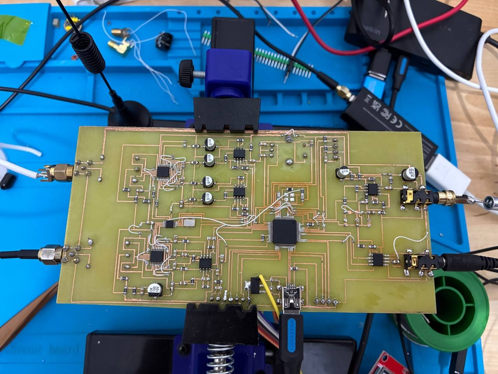

# STM32 SDR

A homebrew software-defined radio built around an STM32F103 (Cortex-M3), a Tayloe (quadrature switching) mixer
and an Si5351 clock generator. It works two ways:

- **Standalone SSB transceiver**: the MCU demodulates SSB to headphones over I²S and modulates SSB from a
  microphone onto its DAC, with an encoder, an OLED and a 3.5" TFT showing the spectrum and waterfall.
- **USB I/Q front end**: the raw I/Q from the mixer's two ADCs and to its dual DAC is streamed to a PC over
  USB (CDC virtual COM port), where Python scripts bridge it to GNU Radio.



*On the bench: the board, the TFT with spectrum and waterfall, and Gqrx on an RTL-SDR watching the transmitter.*

## Specifications

| | |
| --- | --- |
| Tuning range | 1.4–100 MHz (Si5351 I/Q outputs with the 90° offset; below ~4.9 MHz its PLL runs under the 600 MHz spec). Used and measured so far at 7–28.5 MHz; the mixer and op-amps set the real upper limit |
| Tuning steps | 10 Hz, 100 Hz, 1 kHz, 10 kHz, 100 kHz, 1 MHz (encoder); any 1 Hz value over USB |
| Frequency accuracy | as good as the 25 MHz crystal (no calibration yet). On-board radio: the LO is an exact rational of the crystal plus an exact NCO offset; host streaming: the LO is within ~4 Hz of the request |
| I/Q bandwidth (RX and TX) | 64 kS/s complex, 12-bit: ±32 kHz around the LO, flat to the edge |
| USB I/Q stream | 64 kS/s each way, 2 × 12 bit per sample (256 kB/s each way) |
| SSB audio passband | 300–2800 Hz, USB or LSB; the digital filter rejects the opposite sideband by ≥ 79 dB |
| Receiver audio | 8 kHz internally, 48.913 kHz I²S out, volume 0–255 |
| Spectrum display | ±24 kHz around the dialled frequency (48 kHz across 320 px), 256-point FFT = 250 Hz bins, ~20 frames/s, 80 dB tall |

## Features

- **Local oscillator**: Si5351 over I²C, CLK0/CLK1 = I/Q LO with a 90° phase offset (plus a small trim,
  `SI5351_PHASE_TRIM_DEFAULT`). Tuned to 10 MHz at boot; retune with the encoder or `CMD_SET_FREQ`.
  CLK2 = 8 MHz drives the MCU's HSE (bypass mode) → 72 MHz system clock, so the MCU and the LO are synchronous.
- **Spur-free tuning**: the LO is placed on an 8 kHz grid and the rest is made up digitally by an NCO, which
  removes the comb of clock spurs the receiver otherwise hears (see [Spur-free tuning](#spur-free-tuning)).
- **On-board SSB receiver** ([src/ssb_rx.c](src/ssb_rx.c)): I/Q at 64 kS/s → NCO → decimation to 8 kHz →
  complex 300–2800 Hz band-pass → audio → resampler → I²S (48.913 kHz) to a headphone amplifier.
- **On-board SSB transmitter** ([src/ssb_tx.c](src/ssb_tx.c)): electret mic on PA3 (ADC3, 64 kS/s) → phasing-method
  SSB (same band-pass) → ×8 interpolation → dual DAC (64 kS/s).
- **USB / LSB** for both, switched at runtime (encoder double press or `CMD_SIDEBAND`).
- **Half or full duplex**: receive, transmit, or both at once (`CMD_PTT`, or hold the encoder for RX/TX).
- **Front panel**: 0.91" SSD1306 OLED (128×32) and an EC11 encoder ([src/ui.c](src/ui.c)).
- **Spectrum and waterfall** on a 3.5" ILI9488 TFT, 320×480 portrait ([src/spectrum.c](src/spectrum.c)):
  ±24 kHz around the dialled frequency, scale in kHz and dBFS, hardware-scrolled waterfall.
- **RX sampling**: ADC1 + ADC2 in regular simultaneous mode (PA6 / PA7), triggered by TIM3 at 64 kS/s, DMA in
  circular mode; samples are packed 2×12 bit into 32-bit words.
- **TX**: dual 12-bit DAC (PA4 / PA5) at 64 kS/s, fed by DMA from a FIFO (the mic modulator or the host).
- **USB transport**: framed binary protocol with checksums, flow-control info for TX and overflow counters for
  both directions.
- **PC client**: Python (`pyserial`, `numpy`) + GNU Radio flowgraphs for receiving and transmitting.

The radio DSP is all integer and runs in small chunks between the other main-loop steps, so the I²S audio never
stalls while the display, USB and I²C are busy.

## Front panel

| Control | Action |
| --- | --- |
| Turn | Tune by the current step |
| Short press | Next tuning step, 10 Hz → 1 MHz (the step's digit is underlined on the OLED) |
| Double press | USB ↔ LSB |
| Hold 0.7 s | RX ↔ TX |

The OLED shows the frequency, RX/TX/DX, the sideband and the step; both displays follow host commands too.



*The TFT: dialled frequency, mode (DX = duplex), sideband and step on top; spectrum with the kHz/dBFS scale and the
red line at the dialled frequency; waterfall below.*

The spectrum is centred on the dialled frequency, so signals scroll past the fixed red line while tuning. The DC
spike at the LO is hidden by default (it is not a signal, and with the NCO it would sit off the red line); show it
with `python3 spectrum.py dc 0`. The bottom of the dBFS scale follows the noise floor in 10 dB steps
(0 dBFS = a complex tone at the ADC's full scale, per 250 Hz FFT bin).

## Connections

| Function | MCU pins | Notes |
| --- | --- | --- |
| RX I / Q (ADC1 / ADC2) | PA6 / PA7 | mixer baseband amplifiers |
| TX I / Q (DAC1 / DAC2) | PA4 / PA5 | to the TX mixer |
| Microphone (ADC3) | PA3 | |
| I²C1: Si5351 + SSD1306 | PB6 SCL, PB7 SDA | |
| Si5351 CLK2 → HSE | OSC_IN | 8 MHz, bypass mode |
| I²S (SPI3) → headphone amplifier | PA15 WS, PB3 CK, PB5 SD | 48.913 kHz |
| ILI9488 TFT (SPI2, 9 MHz) | PB13 SCK, PB15 MOSI, PB14 DC, PB12 CS | RESET not driven |
| EC11 encoder | PA1 / PA2, switch PA0 | |

The SPI and I²C pins run with slow (2 MHz) edges: with fast edges their bursts reached the RX amplifiers.

## Spur-free tuning

With the LO a little off a round frequency, the receiver showed a dense comb of spurs (up to +50 dB at
10.001 MHz) that moved as you tuned. Measurements traced it to harmonics of the
LO mixing with harmonics of the board clocks, all multiples of 1 MHz: the 8 MHz CLK2/MCU clock and the 25 MHz
Si5351 crystal. For example, 4 × 10.001 MHz − 5 × 8 MHz = 4 kHz and 5 × 10.001 MHz − 2 × 25 MHz = 5 kHz.
These products land on multiples of gcd(LO, 1 MHz) from the LO and are folded by the 64 kHz sampling.

It doesn't depend on how the PLL is configured (fractional PLL or fractional output divider look the same).
It doesn't come in through the antenna or USB either: a 50 Ω load and battery power changed nothing.

With the LO on a **multiple of 8 kHz**, every product lands on a multiple of 8 kHz and only a few weak lines
are left. So in the on-board receive mode ([src/tune.c](src/tune.c)):

1. The LO goes to the nearest 8 kHz grid point on the side away from the SSB band: for USB 0–8 kHz below the
   dialled frequency, for LSB 0–8 kHz above. The LO is an exact rational of the 25 MHz crystal.
2. The remaining offset is applied digitally: an NCO (1024-point sine table, [inc/nco.h](inc/nco.h)) rotates the
   64 kHz I/Q before demodulation.
3. The spectrum display reads the FFT shifted by the same offset, so the picture stays put relative to the dial.

The LO is tuned exactly to the dialled frequency (no NCO) when transmitting, in duplex and while the host
streams I/Q. On transmit, a shifted signal would bring the 64 kHz DAC's image close; duplex has no CPU to spare
for two NCOs; and the host expects the dialled frequency at 0 Hz. A single weak line can still fall in the audio
band when it covers an exact multiple of 8 kHz; that is the limit of the method, the rest needs hardware work
(Si5351 supply decoupling, a TCXO instead of the crystal, shielding).

## Results

### Transmit

I/Q streamed from the PC through the DAC and upconverted around 10 MHz, received by an RTL-SDR in Gqrx (USB mode at 10.001300 MHz):



### The board



*The prototype board: RF connectors on the left edge, the RX and TX mixers with their op-amps next to them,
Si5351 and its crystal in the middle, STM32F103 to the right of centre, audio jacks on the right edge, mini-USB at
the bottom.*

## Repository layout

| Path | Contents |
| --- | --- |
| [src/](src/), [inc/](inc/) | Firmware: ADC/DAC + DMA, Si5351 driver, tuning + NCO, SSB RX/TX, I²S, spectrum/waterfall, USB CDC, framing protocol, FIFOs, SSD1306/ILI9488/EC11 drivers |
| [libs/](libs/) | Git submodule with STM32F10x StdPeriph 3.6.1, CMSIS 4.3.0, USB-FS device driver 4.1.0 and startup code |
| [ldscripts/](ldscripts/) | Linker scripts for STM32F103RE |
| [tools/](tools/) | Generators for the filter taps, NCO and spectrum tables |
| [client/](client/) | Python host library, control and RX/TX scripts, GNU Radio flowgraphs |
| [docs/](docs/) | Photos and screenshots |

## Building the firmware

Requirements: CMake ≥ 3.20, an `arm-none-eabi` GCC toolchain (configured in [cubeide-gcc.cmake](cubeide-gcc.cmake)),
OpenOCD and an ST-Link V2.

```sh
git clone --recursive https://github.com/7ingsong/stm32-tayloe-sdr.git
cd stm32-tayloe-sdr

make            # release build (-O3) -> build/stm32_cmake.elf
make debug      # debug build (-O0): several times slower, the radio DSP and the TFT fall behind
make upload     # flash via ST-Link + OpenOCD
make reset      # reset the target
make clean
```

If you cloned without `--recursive`, run `git submodule update --init` first.

## Running the PC client

```sh
cd client
pip install pyserial numpy matplotlib
```

The device is auto-detected as a USB CDC serial port (see `auto_detect_port` in [client/iqlib.py](client/iqlib.py)).

**Receive**: open [client/radio_iq_rx.grc](client/radio_iq_rx.grc) in GNU Radio Companion (UDP source on port 2001), then:

```sh
python3 recv.py
```

`recv.py` starts the RX stream, converts the 12-bit samples to `complex64` and sends them to GNU Radio over UDP,
so the flowgraph can be (re)started at any time.

**Transmit**: open [client/radio_iq_tx.grc](client/radio_iq_tx.grc) (TCP sink serving I/Q on port 2002), then:

```sh
python3 send.py
```

`send.py` polls the device for free FIFO space and sends exactly that much I/Q. It also has built-in test
generators (`SinTx`, `SinTxNoLUT`, `GenMeander`) you can swap in place of the GNU Radio source.

**Both at once**: `python3 duplex.py` runs RX (UDP 2001) and TX (TCP 2002) together; type `f 7100000` to retune,
`f` to show the frequency, `q` to quit.

**On-board radio controls** (each prints the value in effect; no argument just reads it):

| Script | Usage |
| --- | --- |
| [ptt.py](client/ptt.py) | `python3 ptt.py on \| off \| duplex` — transmit / receive / both |
| [sideband.py](client/sideband.py) | `python3 sideband.py usb \| lsb` |
| [volume.py](client/volume.py) | `python3 volume.py 0..255` — headphone volume (16 at boot, each doubling +6 dB) |
| [mic_gain.py](client/mic_gain.py) | `python3 mic_gain.py 0..255` — microphone gain (16 at boot) |
| [spectrum.py](client/spectrum.py) | `python3 spectrum.py [rise N] [fall N] [smooth 0\|1] [dc 0\|1]` — TFT smoothing and DC hiding |

## USB protocol

Every packet, in both directions:

| Offset | Size | Field |
| --- | --- | --- |
| 0 | 2 | Magic `A5 5A` |
| 2 | 1 | Command / response code |
| 3 | 1 | Sequence number |
| 4 | 2 | Payload length (LE, max 256) |
| 6 | 2 | Checksum (LE): 16-bit byte sum of cmd, seq, len and payload |
| 8 | n | Payload |

| Command | Code | Response |
| --- | --- | --- |
| `CMD_PING` | `0x01` | `RESP_ACK` with `"PONG"` |
| `CMD_IQ_STREAM_TX` | `0x31` | — (payload is appended to the DAC FIFO) |
| `CMD_IQ_STREAM_TX_INFO` | `0x32` | `RESP_IQ_STREAM_TX_INFO` (`0xB2`): block size, free space, underrun / overflow counters |
| `CMD_IQ_STREAM_TX_START` / `_STOP` | `0x33` / `0x34` | `RESP_ACK`. The DAC runs from boot for the on-board radio (see `CMD_PTT`); `START` hands the DAC to the host stream (and idles the on-board radio), `STOP` gives it back |
| `CMD_IQ_STREAM_RX_START` / `_STOP` | `0x35` / `0x36` | `RESP_ACK`; while running, the device sends `RESP_IQ_STREAM_RX` (`0xB1`) frames of 256 bytes. The ADC itself runs from boot (it also feeds the on-board SSB receiver), these only gate the USB stream |
| `CMD_SET_FREQ` | `0x40` | Payload: dialled frequency in Hz as `uint32` LE (1.4–100 MHz), or empty to just read it. `RESP_ACK` with the frequency in effect as `uint32` LE; out of range → `ERR_BAD_PAYLOAD`. While the host streams I/Q the LO sits exactly on it |
| `CMD_PTT` | `0x42` | On-board radio mode. Payload `uint8`: `0` = receive (SSB demodulator on I²S; DAC silent), `1` = transmit (mic → SSB modulator → DAC; I²S silent), `2` = full duplex (both); empty = just read. Receive at boot. `RESP_ACK` with the mode in effect |
| `CMD_VOLUME` | `0x43` | On-board receiver volume. Payload `uint8` 0..255 (0 = mute, 8 ≈ −30 dBFS at full-scale input, each doubling +6 dB; 16 at boot), empty = just read. `RESP_ACK` with the volume |
| `CMD_MIC_GAIN` | `0x44` | On-board transmitter mic gain. Payload `uint8` 0..255 (0 = silence, 16 ≈ full-scale mic → full-scale DAC, each doubling +6 dB; 16 at boot), empty = just read. `RESP_ACK` with the gain |
| `CMD_SPECTRUM` | `0x45` | TFT spectrum settings. Payload `[rise_shift, fall_shift, smooth_bins]` or `[rise_shift, fall_shift, smooth_bins, dc_remove]` (shifts 0..7: each frame a bin moves 1/2^n of the way to its new level, 0 = jump; smooth_bins 0/1 = average neighbouring bins 1-2-1; dc_remove 0/1 = hide the DC spike at the LO, 1 at boot), empty = just read. `RESP_ACK` with the 4 values in effect |
| `CMD_SIDEBAND` | `0x46` | On-board receiver and transmitter sideband. Payload `uint8`: `0` = USB, `1` = LSB; empty = just read. USB at boot. `RESP_ACK` with the sideband in effect |

Errors come back as `RESP_ERR` (`0x81`) with `[error_code, detail]` — see [inc/command.h](inc/command.h) for the codes.
